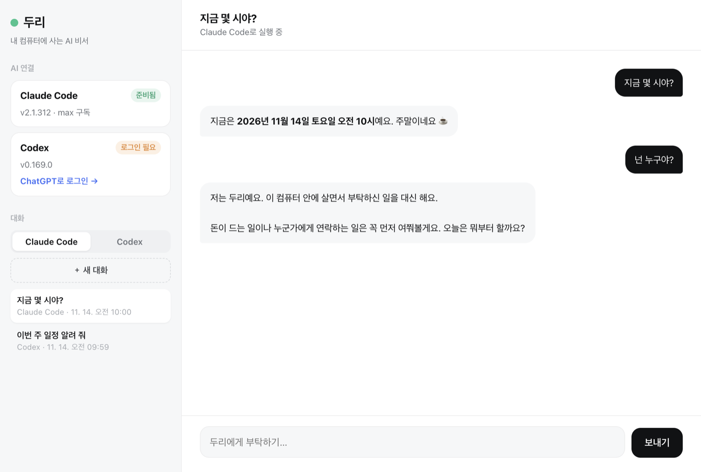
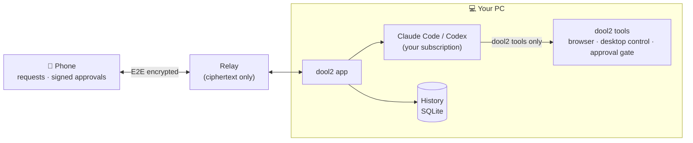

<div align="center">

# dool2 (두리)

**An AI assistant that lives on your own computer. Ask from your phone, and your PC does the work.**

[](https://github.com/kuzvo-dev/dool2/actions/workflows/ci.yml)
[](LICENSE)


[Website](https://dool2.com) · [Docs (Korean)](docs/README.md) · [Contributing](CONTRIBUTING.md) · [한국어](README.md)

</div>

<p align="center">
  
</p>

> [!WARNING]
> dool2 is **pre-alpha**. There is no installer for end users yet, and things change often. There is no compatibility promise before `v1.0`.

## What is dool2?

dool2 is an **open-source personal AI assistant that runs on your own Mac or Windows PC**. You send a request from your phone, such as "find me a KTX train to Busan next Friday". The computer you leave on at home then does the task using your usual browser and apps.

- **Uses the AI subscription you already have.** dool2 runs Claude Code or Codex (ChatGPT) under your own account, and dool2 itself is free.
- **Always asks before spending money.** Payments, bookings and sending messages run only after you approve them. That rule is enforced by code, not by the AI.
- **Your conversations stay on your computer.** The phone and PC talk over an end-to-end encrypted channel, and the relay only forwards ciphertext.
- **Built to get Korean services done without getting blocked.** dool2 uses your real, signed-in Chrome. When a CAPTCHA or identity check appears, it hands the screen to you instead of trying to bypass it.

dool2 is **Korean-first**. The UI, the assistant's persona and most docs are in Korean, and the skills target Korean services. Contributions in English are welcome.

## How it works



1. dool2 runs the **official, unmodified Claude Code (`claude -p`) or Codex (`codex app-server`)** binary, signed in by the user.
2. The agent's built-in shell, file and web tools are disabled. It can **only use dool2's MCP tools**, so there is no path to risky actions without approval.
3. Risky actions pass through an **approval gate**. Paying and contacting people require a signature from your phone, which the PC verifies.

See the [architecture doc](docs/architecture.md) (Korean) for details.

## Roadmap

The PC side is built first. The phone app and relay come last.

| Milestone           | Scope                                                                                                   | Status  |
| ------------------- | ------------------------------------------------------------------------------------------------------- | ------- |
| M0 Skeleton         | Monorepo, Claude Code and Codex adapters, chat in the PC app, history, persona                          | ✅ Done |
| M1 Install & setup  | First-run wizard, AI sign-in, automatic installation of required components, power settings, self-check | ✅ Done |
| M1+ Pay as you go   | No subscription needed: bring an API key via OpenCode, per-turn cost shown                              | ✅ Done |
| M2 Browser          | dool2 Chrome extension, browser tools, hand-off, login vault, first skill                               | ✅ Done |
| M3 Approval gate    | Risk tiers, signed approvals, gate regression tests                                                     | Planned |
| M4 Desktop & skills | App control (e.g. KakaoTalk PC), Korean service skills                                                  | Planned |
| M5 Distribution     | Signed and notarized installers, auto-update                                                            | Planned |
| M6 Phone            | Phone app, QR pairing, relay, biometric signing                                                         | Planned |

## Running from source

Requirements:

- Node.js 24+ ([`.nvmrc`](.nvmrc)) and pnpm (`corepack enable` picks the pinned version).
- To actually chat, you need one of:
  - [Claude Code](https://code.claude.com/docs), installed and signed in.
  - Codex. A pinned version is bundled; use "Sign in with ChatGPT" in the app.

```bash
git clone https://github.com/kuzvo-dev/dool2.git
cd dool2
corepack enable
pnpm install
pnpm build

pnpm dev:desktop   # desktop app (Electron)
pnpm dev:daemon    # headless daemon; prints the local URL and token

pnpm lint && pnpm build && pnpm typecheck && pnpm test
```

## Contributing

Bug reports, ideas, code and **skills** (how-to guides for Korean services) are all welcome. See [CONTRIBUTING.md](CONTRIBUTING.md) and the [Code of Conduct](CODE_OF_CONDUCT.md). Report security issues privately as described in [SECURITY.md](SECURITY.md).

## License

- Code: [Apache License 2.0](LICENSE)
- Skills (`skills/`): [CC BY-SA 4.0](https://creativecommons.org/licenses/by-sa/4.0/)
- The name "두리 / dool2" and its logo are trademarks. Forks must use a different name and logo. See [TRADEMARKS.md](TRADEMARKS.md).

Claude and Claude Code are trademarks of Anthropic. ChatGPT and Codex are trademarks of OpenAI. dool2 is an independent project, and neither company affiliates with or endorses it.
