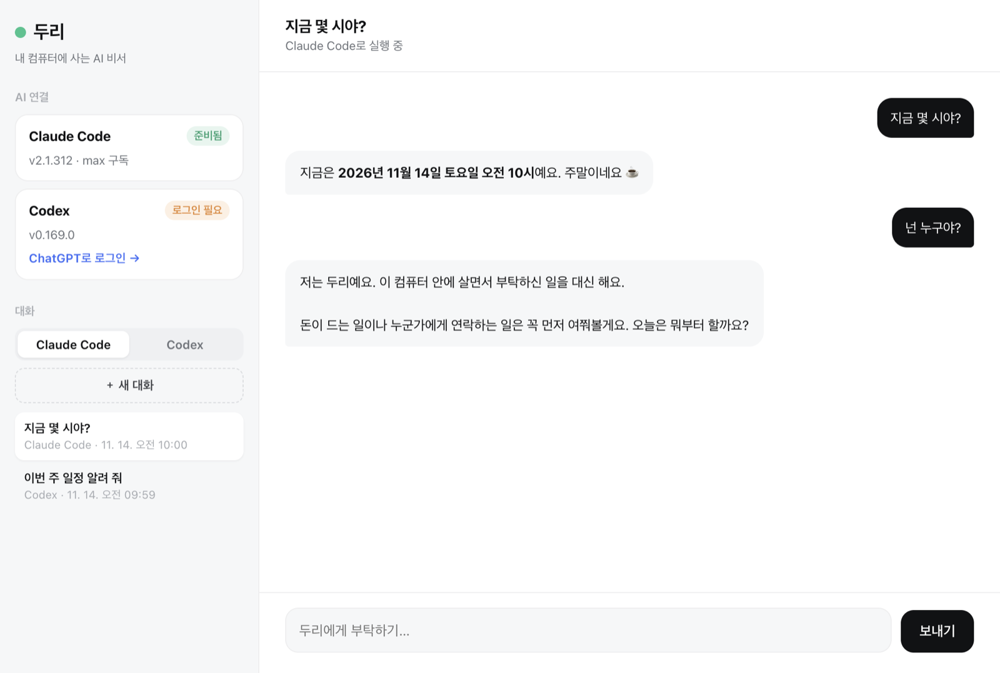
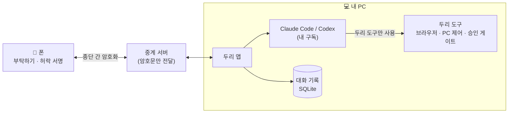

<div align="center">

# 두리 (dool2)

**내 컴퓨터에 사는 AI 비서 — 부탁은 폰으로, 일은 내 컴퓨터가.**

[](https://github.com/kuzvo-dev/dool2/actions/workflows/ci.yml)
[](LICENSE)
[](docs/open-source.md#라이선스와-상표)


[홈페이지](https://dool2.com) · [문서](docs/README.md) · [로드맵](docs/architecture.md#10-단계별-계획-대략) · [기여하기](CONTRIBUTING.md) · [English](README.en.md)

</div>

<p align="center">
  
</p>

> [!WARNING]
> 두리는 아직 **개발 초기(pre-alpha)** 예요. 일반 사용자용 설치 파일은 없고, 기능과 구조가 자주 바뀌어요. `v1.0` 전까지는 호환성을 약속하지 않아요.

## 두리는 무엇인가요

두리는 **내 PC(맥·윈도우)에서 돌아가는 오픈소스 AI 비서**예요. 폰으로 "다음 주 금요일 부산 가는 KTX 찾아 줘"라고 부탁하면, 집에 켜 둔 내 컴퓨터가 평소 쓰던 브라우저와 프로그램으로 대신 일을 해요.

- **내가 이미 쓰는 AI 구독으로 돌아가요.** Claude Code 또는 Codex(ChatGPT)를 사용자 계정 그대로 써요. 두리 이용료는 0원이에요.
- **돈 쓰는 일은 꼭 먼저 물어봐요.** 결제·예약·메시지 보내기처럼 되돌리기 어려운 일은 사용자가 허락해야만 실행돼요. 이 규칙은 AI가 아니라 코드가 강제해요.
- **대화는 내 컴퓨터에만 남아요.** 폰과 PC 사이는 종단 간 암호화로 연결하고, 중계 서버는 암호문만 전달해요.
- **한국 서비스를 막히지 않고 끝까지.** 평소 로그인된 내 Chrome을 쓰고, 캡차·본인인증이 나오면 우회하지 않고 사람에게 화면을 넘겨요.

## 어떻게 동작하나요



1. 두리는 사용자가 설치·로그인한 **공식 Claude Code(`claude -p`) 또는 Codex(`codex app-server`)** 를 수정 없이 실행해요.
2. AI의 기본 셸·파일·웹 기능은 끄고, **두리 도구(MCP)만** 쓰게 해요. 그래서 허락 없이 위험한 일을 할 길이 없어요.
3. 위험한 동작은 **승인 게이트**를 거쳐요. 결제·연락은 폰에서 서명해야 실행되고, PC가 서명을 검증해요.

자세한 설계는 [아키텍처 문서](docs/architecture.md)에 있어요.

## 지금 어디까지 왔나요

PC 쪽을 먼저 끝까지 만들고, 폰 앱과 중계 서버는 마지막에 붙여요.

| 단계            | 내용                                                             | 상태       |
| --------------- | ---------------------------------------------------------------- | ---------- |
| M0 뼈대         | 모노레포, Claude Code·Codex 연동, PC 창에서 대화, 기록, 페르소나 | ✅ 완료    |
| M1 설치·첫 설정 | 첫 실행 마법사, AI 로그인, 부품 자동 설치, 전원 설정, 자가 점검  | 🚧 진행 중 |
| M1+ 종량제 모드 | 구독 없이 API 키로 쓴 만큼만 (OpenCode), 사용 금액 표시          | 예정       |
| M2 브라우저 손  | 두리 Chrome 확장, 브라우저 도구, 캡차 넘겨받기                   | 예정       |
| M3 승인 게이트  | 위험도 분류, 허락 서명, 게이트 회귀 테스트                       | 예정       |
| M4 PC 제어·스킬 | 카카오톡 PC 등 앱 제어, 한국 서비스 스킬                         | 예정       |
| M5 배포         | 서명·공증된 원터치 설치 파일, 자동 업데이트                      | 예정       |
| M6 폰           | 폰 앱, QR 페어링, 중계 서버, 생체인증 서명                       | 예정       |

## 개발 환경에서 실행하기

> 일반 사용자용 설치 파일은 M5에서 나와요. 지금은 개발자용 실행 방법만 있어요.

**준비물**

- Node.js 24 이상 ([`.nvmrc`](.nvmrc)), pnpm (`corepack enable`이면 레포가 정한 버전으로 맞춰져요)
- 대화를 해 보려면 둘 중 하나:
  - [Claude Code](https://code.claude.com/docs) 설치 후 `claude` 로그인
  - Codex는 레포에 고정 버전이 들어 있어요. 앱의 "ChatGPT로 로그인" 버튼을 쓰면 돼요

```bash
git clone https://github.com/kuzvo-dev/dool2.git
cd dool2
corepack enable
pnpm install
pnpm build

pnpm dev:desktop   # PC 앱 실행 (Electron)
pnpm dev:daemon    # 화면 없이 두리 본체만 실행 (로컬 주소와 토큰이 출력돼요)
```

검사는 이렇게 해요. PR을 올리기 전에도 같은 명령을 돌려요.

```bash
pnpm lint && pnpm build && pnpm typecheck && pnpm test
```

## 레포 구성

```
apps/
  desktop/        PC 앱 (Electron) — 창, 트레이, 설정
  daemon/         두리 본체 dool2d — 로컬 API, 대화 실행, 기록
packages/
  protocol/       앱·본체·폰이 함께 쓰는 타입과 규약
  engine/         대화 진행, 에이전트 공통 인터페이스, 페르소나
  agent-claude/   Claude Code 연동 (`claude -p`, 내장 도구 끔)
  agent-codex/    Codex 연동 (`codex app-server`, 셸 끔, 고정 버전 동봉)
  mcp-tools/      두리 도구 (MCP 서버)
  browser/        브라우저 손 — Chrome 확인·설치 (M2에서 두리 확장 연결)
  store/          대화 기록 (Node 내장 SQLite)
docs/             설계·운영 문서
```

## 문서

| 문서                                        | 내용                                                                  |
| ------------------------------------------- | --------------------------------------------------------------------- |
| [아키텍처](docs/architecture.md)            | 전체 구조, 에이전트 연동, 승인 게이트, 브라우저·PC 제어, 설치, 로드맵 |
| [페르소나](docs/persona.md)                 | 두리의 성격과 말투. 사용자에게 보이는 모든 문구의 기준                |
| [오픈소스 운영](docs/open-source.md)        | 공개 범위, 라이선스, 수익 구조, 거버넌스                              |
| [결정 기록 (ADR)](docs/decisions/README.md) | 구조에 관한 결정과 그 이유                                            |
| [위협 모델](docs/security/threat-model.md)  | 무엇을 지키고, 무엇은 못 막는지                                       |
| [전체 문서 목록](docs/README.md)            |                                                                       |

## 기여하기

버그 제보, 아이디어, 코드, 그리고 **한국 서비스 사용법(스킬)** 기여를 모두 환영해요. 개발자가 아니어도 "이 사이트는 이렇게 예약해요" 같은 스킬 문서로 기여할 수 있어요.

- 시작하기 전에 [기여 안내](CONTRIBUTING.md)와 [행동 강령](CODE_OF_CONDUCT.md)을 읽어 주세요.
- 질문과 아이디어는 [Discussions](https://github.com/kuzvo-dev/dool2/discussions), 버그와 할 일은 [Issues](https://github.com/kuzvo-dev/dool2/issues)에 올려 주세요.
- 보안 취약점은 공개 이슈 대신 [비공개 신고](SECURITY.md)로 알려 주세요.

## 라이선스

- 코드: [Apache License 2.0](LICENSE)
- 스킬(`skills/`): [CC BY-SA 4.0](https://creativecommons.org/licenses/by-sa/4.0/deed.ko)
- "두리" 이름과 로고는 상표예요. 포크해서 배포할 때는 이름과 로고를 바꿔 주세요. 자세한 건 [상표 정책](TRADEMARKS.md)을 봐 주세요.

Claude와 Claude Code는 Anthropic의 상표이고, ChatGPT와 Codex는 OpenAI의 상표예요. 두리는 두 회사와 제휴하거나 보증받지 않은 독립 프로젝트예요.
