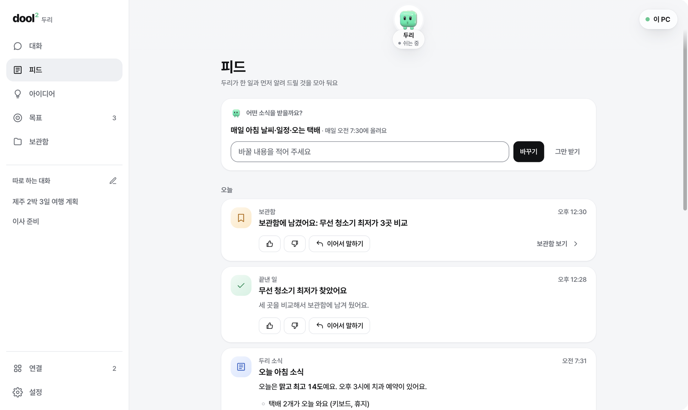
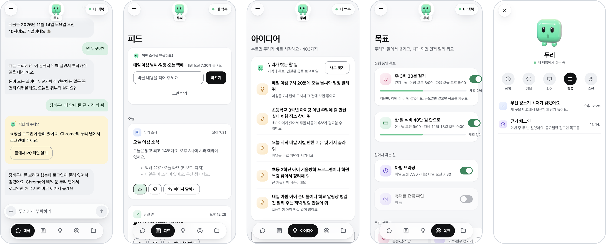
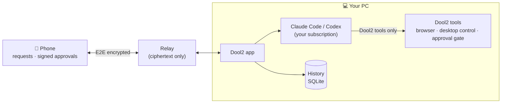

<div align="center">

# Dool2 (두리)

**An AI assistant that lives on your own computer. Ask from your phone, and your PC does the work.**

[](https://github.com/kuzvo-dev/dool2/actions/workflows/ci.yml)
[](LICENSE)


[Website](https://dool2.com) · [Docs](docs/README.md) · [Contributing](CONTRIBUTING.md) · [한국어](README.ko.md)

</div>

<p align="center">
  <picture>
    <source media="(prefers-color-scheme: dark)" srcset="docs/assets/pc-feed-dark.png">
    
  </picture>
</p>

> [!WARNING]
> Dool2 is **pre-alpha**. There is no installer for end users yet, and things change often. There is no compatibility promise before `v1.0`.

## What is Dool2?

Dool2 is an **open-source personal AI assistant that runs on your own Mac or Windows PC**. You send a request from your phone, such as "find me a KTX train to Busan next Friday". The computer you leave on at home then does the task using your usual browser and apps.

- **Uses the AI subscription you already have.** Dool2 runs Claude Code or Codex (ChatGPT) under your own account, and Dool2 itself is free.
- **Always asks before spending money.** Payments, bookings and sending messages run only after you approve them. That rule is enforced by code, not by the AI.
- **Your conversations stay on your computer.** The phone and PC talk over an end-to-end encrypted channel, and the relay only forwards ciphertext.
- **Built to get Korean services done without getting blocked.** Dool2 uses your real, signed-in Chrome. When a CAPTCHA or identity check appears, it hands the screen to you instead of trying to bypass it.

Dool2 is **Korean-first, going multilingual**. Korean services and the Korean UI are the most complete today. English UI is in progress, and Japan and Taiwan are next ([ADR 0029](docs/decisions/0029-language-and-region.md)). The repo, docs and discussions are in English, and Korean contributions are welcome too.

## What it does

<p align="center">
  <picture>
    <source media="(prefers-color-scheme: dark)" srcset="docs/assets/phone-tabs-dark.png">
    
  </picture>
</p>

Both the phone and desktop apps have five tabs.

- **Chat**: one continuous conversation. You can keep sending messages while Dool2 is answering, and send photos such as receipts or screenshots.
- **Feed**: tell Dool2 what to report (for example "weather, schedule and incoming parcels every morning") and it posts on schedule. Finished tasks show up here too.
- **Ideas**: about 400 things you can ask, in 16 categories (groceries, money, trains and flights, paperwork, family and more), plus personal suggestions refreshed every morning from memory, goals and connected services.
- **Goals**: say "exercise three times a week" or "check my phone bill every month" in chat, and Dool2 makes a plan and checks in on schedule.
- **Library**: comparison tables, itineraries, links and photos Dool2 made or received.
- **Assistant panel**: tap the character to see upcoming runs, memory, a live view of the Chrome tab Dool2 is using, activity and approvals. Set how Dool2 addresses you, its tone and answer length here.
- **84 Korean service connections**: enter your ID and password once. They are encrypted in the PC's vault and the Dool2 daemon signs in for you, so the AI never sees the password. CAPTCHAs and identity checks are streamed live to your phone so you can finish them yourself.

## How it works



1. Dool2 runs the **official, unmodified Claude Code (`claude -p`) or Codex (`codex app-server`)** binary, signed in by the user.
2. The agent's built-in shell, file and web tools are disabled. It can **only use Dool2's MCP tools**, so there is no path to risky actions without approval.
3. Risky actions pass through an **approval gate**. Paying and contacting people require a signature from your phone, which the PC verifies.

See the [architecture doc](docs/architecture.md) for details.

## Roadmap

Both the desktop and phone apps work end to end as a test build. Next up is an installer anyone can use (M5).

| Milestone           | Scope                                                                                                                | Status        |
| ------------------- | -------------------------------------------------------------------------------------------------------------------- | ------------- |
| M0 Skeleton         | Monorepo, Claude Code and Codex adapters, chat in the PC app, history, persona                                       | ✅ Done       |
| M1 Install & setup  | First-run wizard, AI sign-in, automatic installation of required components, power settings, self-check              | ✅ Done       |
| M1+ Pay as you go   | No subscription needed: bring an API key via OpenCode, per-turn cost shown                                           | ✅ Done       |
| M2 Browser          | Dool2 Chrome extension, browser tools, hand-off, login vault, first skill                                            | ✅ Done       |
| M3 Approval gate    | Risk tiers, approval screens, gate regression tests                                                                  | ✅ Done       |
| M6 Phone            | Phone app, QR pairing, relay, approvals signed with the phone's key, push, remote view of the PC tab                 | ✅ Test build |
| Life assistant      | Five tabs (Chat, Feed, Ideas, Goals, Library), memory, scheduled runs, photos, assistant settings                    | ✅ Test build |
| M4 Desktop & skills | 84 service connections with sign-in on your behalf, app control such as KakaoTalk PC (macOS permission testing left) | In progress   |
| M5 Distribution     | Signed and notarized installers, auto-update, an always-on relay                                                     | Next          |

## Running from source

Requirements:

- Node.js 24+ ([`.nvmrc`](.nvmrc)) and pnpm (`corepack enable` picks the pinned version).
- To actually chat, you need one of:
  - [Claude Code](https://code.claude.com/docs), installed and signed in.
  - Codex. A pinned version is bundled; use "Sign in with ChatGPT" in the app.

```bash
git clone https://github.com/kuzvo-dev/dool2.git
cd dool2
corepack enable
pnpm install
pnpm build

pnpm dev:desktop   # desktop app (Electron)
pnpm dev:daemon    # headless daemon; prints the local URL and token

pnpm lint && pnpm build && pnpm typecheck && pnpm test
```

## Repository layout

```
apps/
  desktop/        Desktop app (Electron): window, tray, settings
  daemon/         Dool2 daemon dool2d: local API, runs conversations, history
  extension/      Dool2 Chrome extension: a thin hand with no judgment (chrome.debugger + native messaging)
  hands-mac/      Desktop control helper (macOS, Swift): reads the accessibility tree, clicks and types, captures windows
  phone/          Phone app: Chat, Feed, Ideas, Goals, Library, approvals, live view of the PC
  relay/          Relay: passes only encrypted messages between phone and PC
packages/
  ui/             Design system: tokens and parts (CSS) shared by the apps and the extension, Pretendard
  protocol/       Types and contracts shared by the apps, the daemon and the phone
  engine/         Conversation flow, common agent interface, persona
  agent-claude/   Claude Code integration (`claude -p`, built-in tools off)
  agent-codex/    Codex integration (`codex app-server`, shell off, pinned version fetched on first use)
  agent-opencode/ Pay-as-you-go runner (OpenCode v2, API key, Dool2 tools only)
  mcp-tools/      Dool2 tools (MCP server): status, open, read, click, type and view the browser
  browser/        Browser hand: checks and installs Chrome, links the extension and the daemon
  store/          Conversation history (Node's built-in SQLite)
skills/           Connect cards and connectors for 84 services, mostly Korean (CC BY-SA 4.0)
docs/             Design and operations docs (Korean originals in docs/ko/)
```

## Docs

| Doc                                                | What it covers                                                                                     |
| -------------------------------------------------- | -------------------------------------------------------------------------------------------------- |
| [Architecture](docs/architecture.md)               | Overall structure, agent integration, approval gate, browser and desktop control, install, roadmap |
| [Persona](docs/persona.md)                         | Dool2's character and voice, the basis for all user-facing copy                                    |
| [Design system](packages/ui/README.md)             | Screen principles, tokens, parts. Samples in `packages/ui/preview.html`                            |
| [Open source](docs/open-source.md)                 | What is public, licenses, business model, governance                                               |
| [Decision records (ADR)](docs/decisions/README.md) | Architecture decisions and why                                                                     |
| [Threat model](docs/security/threat-model.md)      | What we protect, and what we cannot prevent                                                        |
| [Glossary](docs/i18n/glossary.md)                  | Terms used across docs, code and UI copy                                                           |
| [All docs](docs/README.md)                         |                                                                                                    |

## Contributing

Bug reports, ideas, code and **skills** (how-to guides for Korean services) are all welcome. See [CONTRIBUTING.md](CONTRIBUTING.md) and the [Code of Conduct](CODE_OF_CONDUCT.md). Report security issues privately as described in [SECURITY.md](SECURITY.md).

## License

- Code: [Apache License 2.0](LICENSE)
- Skills (`skills/`): [CC BY-SA 4.0](https://creativecommons.org/licenses/by-sa/4.0/)
- The name "두리 / Dool2" and its logo are trademarks. Forks must use a different name and logo. See [TRADEMARKS.md](TRADEMARKS.md).

Claude and Claude Code are trademarks of Anthropic. ChatGPT and Codex are trademarks of OpenAI. Dool2 is an independent project, and neither company affiliates with or endorses it.
