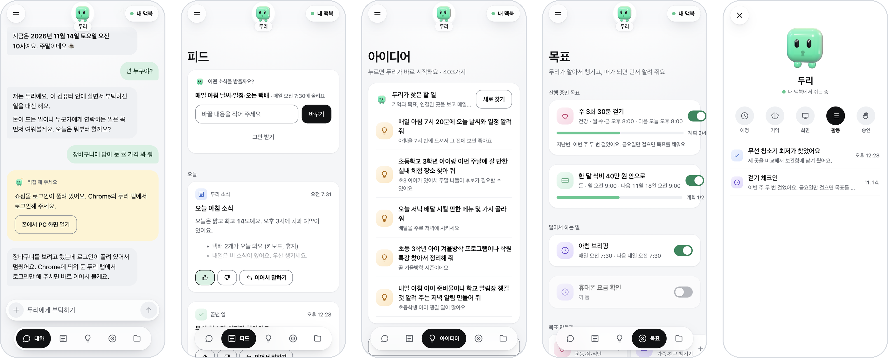

# @dool2/phone

두리 **폰 앱**(PWA)이에요. 설치 없이 폰 브라우저로 열고, 홈 화면에 추가해 앱처럼 써요. 중계 서버가 `/app/`으로 내려줘요([ADR 0012](../../docs/decisions/0012-phone-link.md)).

```bash
pnpm build                                   # → apps/phone/dist
pnpm --filter @dool2/relay start             # http://127.0.0.1:8787/app/
```

## 화면



1. **연결**: PC 두리 앱의 설정 → 폰 연결에서 QR을 찍으면 열려요. 폰과 PC에 같은 확인 코드 6자리가 보이고, PC에서 [같아요, 연결]을 누르면 끝나요.
2. **아래 탭 다섯 개**
   - **대화**: 하나로 이어지는 대화. 답하는 중에도 다음 말을 보낼 수 있고, 입력칸 + 로 사진을 보내요.
   - **피드**: 받을 소식 지시, 정해진 때 올라오는 글, 끝낸 일. 좋아요·별로예요·이어서 말하기.
   - **아이디어**: 맞춤 아이디어(매일 아침 새로) + 16개 분류 400여 가지와 찾기. 연결 안 한 곳의 아이디어는 연결하고 바로 시작해요.
   - **목표**: 진행 중인 목표와 알아서 하는 일, 분류별 목표 만들기, 계획 체크·지금 체크인.
   - **보관함**: 만든 것 / 사진·파일.
3. **두리 판**(위 캐릭터): 예정 · 기억(호칭·말투·답 길이) · 화면 · 활동 · 승인
4. **메뉴**: 따로 하는 대화, 연결(서비스 84곳, 아이디·비밀번호로 연결하기), 설정
5. **PC 화면(원격)**: 로그인·로봇 확인처럼 사람이 해야 하는 탭을 폰에서 보고 눌러요(초당 5장 안팎). 누른 자리, 넣은 글자, 지우기·엔터·다음 칸·스크롤이 PC의 그 탭에 전해져요. 넘긴 탭만, 30분 동안만 돼요
6. **승인**: PC 화면 캡처, 무엇을·어디서·얼마·취소 조건·누를 버튼. [승인하고 "…" 누르기]는 이 폰의 키로 서명해서 보내고, PC가 직접 확인해요

## 지키는 것

- 이 폰의 키는 브라우저 밖으로 **꺼낼 수 없게** 만들어 IndexedDB에 둬요.
- 주고받는 내용은 PC와 이 폰만 열 수 있어요. 대화 내용은 폰에 저장하지 않아요(서비스 워커는 앱 껍데기만 저장).
- 알림 권한은 [알림 켜기]를 눌렀을 때만 물어요. 켜면 앱을 닫아 둬도 **승인 요청·직접 해 주세요·맡긴 일이 끝났을 때** 알림이 와요(웹 푸시, PC가 직접 보내요). 알림을 누르면 그 승인·대화로 바로 가요.
- 아이폰은 사파리 공유 → 홈 화면에 추가한 뒤 거기서 열어야 알림을 받을 수 있어요. 홈 화면에 이 안내가 나와요.
- 오래된 브라우저(X25519 미지원, iOS 16 이하 등)는 안내 화면을 보여 줘요.

## 끝-끝 확인 판

```bash
pnpm build
DOOL2_TEST_CHROME="<Chrome for Testing>" pnpm --filter @dool2/phone live
# → /tmp/dool2-live.json (본체 주소·토큰), 폰 앱 http://127.0.0.1:8787/app/
```

중계 서버(폰 앱 포함) + 두리 본체(진짜 AI) + 시험용 Chrome(두리 확장) + 시험 가게를 함께 띄워요. 폰 대신 브라우저를 휴대폰 크기로 열어 시험해요.
