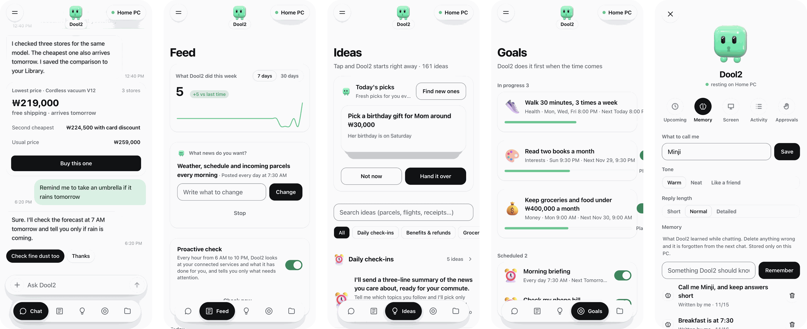

# @dool2/phone

The Dool2 **phone app** (PWA). Open it in the phone browser with no install, and add it to the home screen to use it like an app. The relay serves it at `/app/` ([ADR 0012](../../docs/decisions/0012-phone-link.md)).

```bash
pnpm build                                   # → apps/phone/dist
pnpm --filter @dool2/relay start             # http://127.0.0.1:8787/app/
```

## Screens



1. **Connect**: Scan the QR in the desktop Dool2 app under Settings → Connect phone. The same 6-digit confirmation code appears on the phone and the PC; press [It matches, connect] on the PC and you are done.
2. **Five bottom tabs**
   - **Chat**: One continuous conversation. You can send the next message even while Dool2 is answering, and send photos with + in the input field.
   - **Feed**: Instructions for news to receive, posts that arrive at set times, and finished tasks. Like, dislike, and continue the conversation.
   - **Ideas**: Personalized ideas (new every morning) plus about 160 ideas in 18 categories, with search. For ideas that need a service you have not connected, connect it and start right away.
   - **Goals**: Goals in progress and things Dool2 does on its own, creating goals by category, plan check and check-in now.
   - **Library**: Things made / photos and files.
3. **Assistant panel** (the character at the top): Schedule · Memory (how to address you, tone, answer length) · Screen · Activity · Approvals
4. **Menu**: Separate conversations, Connections (84 services, connect with ID and password), Settings
5. **PC screen (remote)**: Steps only a person can do, such as login or robot checks, are shown and tapped from the phone (about 5 frames per second). Taps, typed text, delete, Enter, next field, and scroll are passed to that tab on the PC. Only handed-off tabs, and only for 30 minutes
6. **Approval**: A capture of the PC screen, and what, where, how much, the cancel conditions, and the button to press. [Approve and press "…"] is signed with this phone's key and sent, and the PC verifies it itself

## What it guarantees

- This phone's key is created as **non-extractable** from the browser and kept in IndexedDB.
- Only the PC and this phone can open what is exchanged. Conversation content is not stored on the phone (the service worker stores only the app shell).
- Notification permission is asked only when you press [Turn on notifications]. Once on, you get notifications even with the app closed for **approval requests, "please do this yourself" requests, and when a task finishes**. Tapping a notification goes straight to that approval or conversation.
  - **Store app** ([ADR 0042](../../docs/decisions/0042-store-app-push.md)): the app makes its own notification key (kept wrapped by the Android Keystore) and sends it with its FCM token to the PC. The PC encrypts each notification with that key and the official relay hands the ciphertext to FCM, so neither Google nor the relay can read it. Building with push needs `android/app/google-services.json` from the Dool2 Firebase project; without it the app builds and Settings says notifications are not available.
  - **Browser** (self-hosted relay): web push, sent directly by the PC.
- On iPhone, you can get notifications only after Safari Share → Add to Home Screen and opening it from there. The home screen shows this guide.
- Old browsers (no X25519 support, iOS 16 and earlier, and so on) get a guidance screen.

## End-to-end check board

```bash
pnpm build
DOOL2_TEST_CHROME="<Chrome for Testing>" pnpm --filter @dool2/phone live
# → /tmp/dool2-live.json (daemon address and token), phone app at http://127.0.0.1:8787/app/
```

This starts the relay (including the phone app), the Dool2 daemon (real AI), a test Chrome (the Dool2 extension), and a test shop together. Instead of a phone, it opens a browser at phone size for testing.
