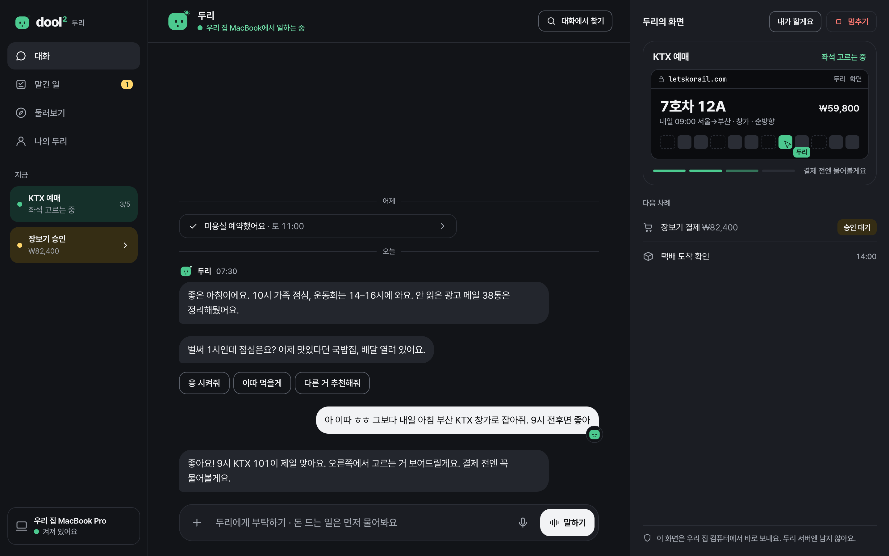
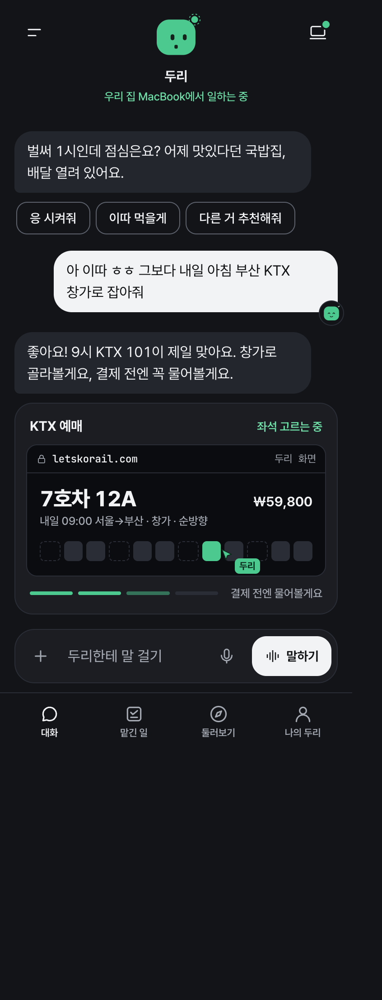
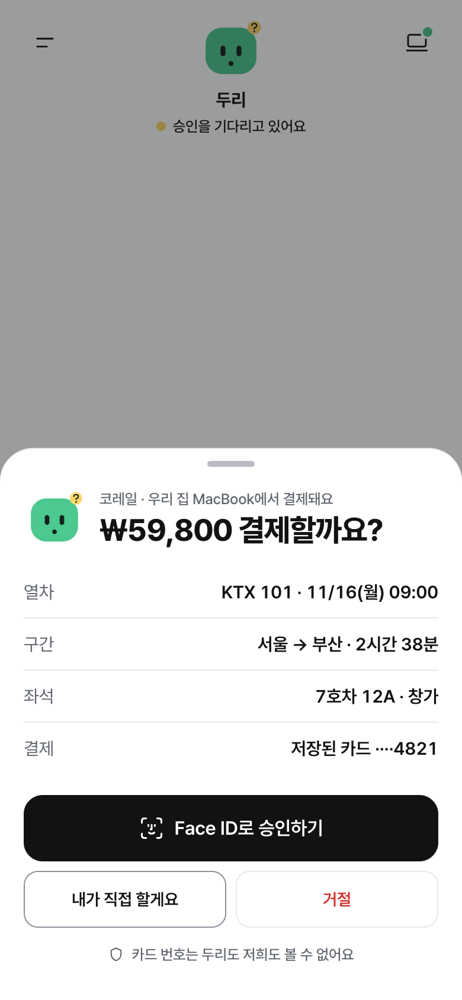

# 두리 디자인 원본

두리 화면(PC 앱·폰 앱·확장 프로그램·랜딩)을 만들 때 기준이 되는 디자인이에요. 디자인 도구에서 만든 원본을 그대로 옮겨 두고, 새 디자인이나 부품이 나오면 여기를 고쳐요.

코드로 옮긴 결과는 [`packages/ui`](../../packages/ui)(토큰·부품 CSS)에 있어요. 둘이 다르면 **이 폴더가 기준**이고, `packages/ui`를 맞춰 고쳐요.

## 한 줄 방향

**깨끗한 도구 위에 민트 친구 하나.** 화면은 흰색·검정·회색 선으로 단정하게 두고, 귀여움은 민트 캐릭터와 "일하는 중" 표시에만 모아요.

1. **하는 일이 보여야 믿는다.** "두리의 화면"과 단계 기록으로 지금 어디서 뭘 하는지 보여 줘요.
2. **돈과 메시지는 사람이 누른다.** 결제·전송은 승인 카드(버터 노랑)에서 멈추고 폰에서 승인해요.
3. **민트는 두리의 색.** 캐릭터, 워드마크의 ², "일하는 중" 점에만 써요. 버튼과 내 말풍선은 검정(다크에서는 흰색)이에요.
4. **카드보다 선.** 1px 선과 회색 면으로 나눠요. 그림자는 떠 있는 것(승인 시트, 팝오버)에만.
5. **대화는 하나.** 주제마다 방을 만들지 않아요. 일상 대화와 맡긴 일이 한 대화에 이어져요.

## 폴더

| 폴더 | 내용 |
| --- | --- |
| [`system/`](system) | 디자인 시스템 원본. [README](system/README.md)(원칙·말투·색·글자·캐릭터·배치·금지 목록), [`tokens.json`](system/tokens.json)(색·글자·여백·모서리·그림자 값), [`components/`](system/components)(부품 7개의 규칙과 견본, `bundle.css`), [`assets/`](system/assets)(캐릭터 표정 6개, 로고) |
| [`screens/`](screens) | 실제 화면 예시 14장(PC 2, 모바일 6×다크·라이트). [README](screens/README.md)에 화면 목록이 있어요 |
| [`guide/`](guide) | 디자인 시스템·화면 가이드 슬라이드 15장 |

## 한눈에 보기

| PC (다크) | 모바일 대화 (다크) | 모바일 결제 승인 (라이트) |
| --- | --- | --- |
|  |  |  |

## 디자인을 고칠 때

1. 디자인 도구에서 고친 뒤 내보내요. 디자인 시스템은 파일을 하나씩 내려받고, 화면은 화면마다 `HTML (.zip)`과 `PNG 2×`로, 가이드는 슬라이드 그림으로 내보내요.
2. 이 폴더의 같은 이름 파일을 바꿔요. 화면 HTML 안의 해시 이름 그림(`./assets/….svg`)은 `system/assets/`의 캐릭터 파일 경로로, 글꼴은 `packages/ui/fonts/`로 바꿔 둬요. 디자인 도구 실행용 파일(`support.js`, `vendor/`)은 넣지 않아요.
3. 새 부품이면 `system/components/<이름>/`에 `README.md`(규칙)와 `preview.html`(견본)을 넣고, `system/README.md`의 부품 목록에도 적어요.
4. 같은 PR이나 바로 다음 PR에서 `packages/ui`(토큰·부품)와 앱 화면을 맞춰요.

## 원본끼리 다를 때

원본 안에서도 서로 어긋나는 데가 있어요. 정할 때는 **화면 예시(`screens/`) → 디자인 시스템 README → 부품 README** 순서로 따라요.

- 두리 말: `components/Message`는 말풍선 없는 글이라고 하지만, 화면 예시와 시스템 README는 회색(`raise`) 말풍선이에요 → **회색 말풍선**.
- 다크 바탕: `tokens.json`은 `#16181d`, 화면 예시와 시스템 README는 `#121418` → **`#121418`**(다크 기본).
- 굵기: 예전 `packages/ui`는 700 이상을 안 썼지만, 새 시스템은 제목에 680–780을 써요 → **새 시스템**.
- 승인 색: 예전 주황(`--warn`) 대신 버터 노랑(`butter`)이에요.
