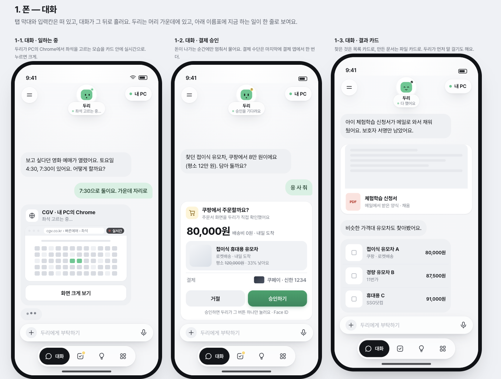
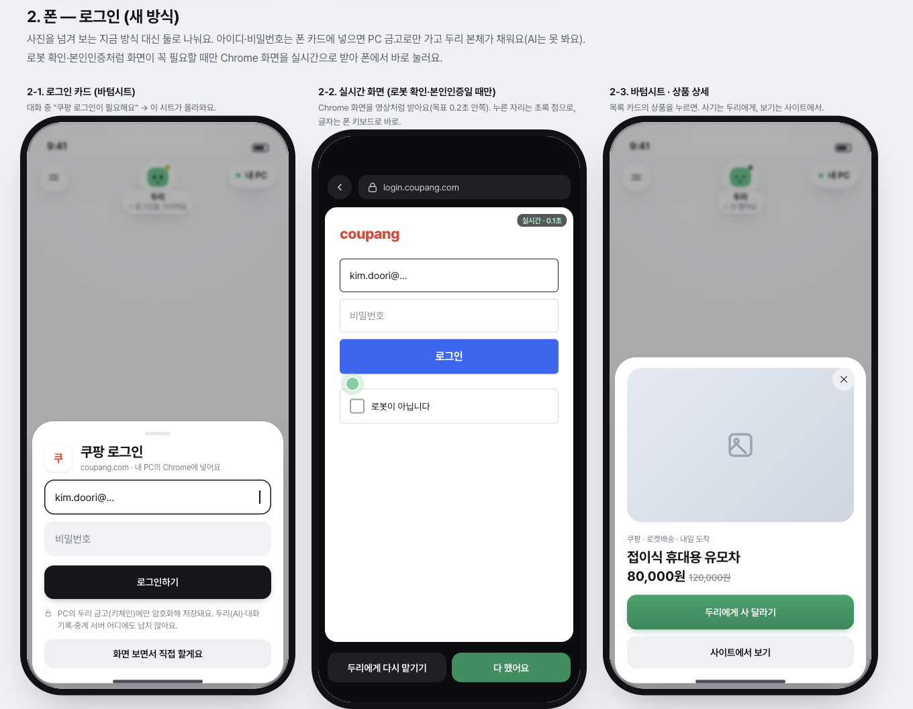

# Dool2 design source

The design that is the standard when building Dool2 screens (desktop app, phone app, extension, landing). It is the original from the design tool, copied over as is; when a new design or component comes out, update it here.

The result translated into code is in [`packages/ui`](../../packages/ui) (tokens and component CSS). If the two differ, **this folder is the standard**, and `packages/ui` is changed to match.

## One-line direction (v2, 2026-11-15)

**One mint friend on a soft surface.** On a very pale gray background, white cards and gray chat bubbles sit, and only the things the hand touches, such as the header button, input field, tab bar and sheets, float like glass. Cuteness is concentrated in the Dool2 character and the "working" indicator. The reference screens are in [`screens/soft/`](screens/soft).

1. **You trust what you can see being done.** The Dool2 name tag in the middle of the header shows what it is doing right now in one line, and the chat shows a live screen card.
2. **A person presses money and messages.** Payment and sending stop at the approval card. The approve button (deep mint) is the heaviest thing on the screen. Yellow is only for the "you're needed" dot and badge.
3. **Mint is Dool2's color.** The character, working state, approve button, and the pale mint bubble for my words.
4. **Surfaces rather than boxes; floating things are glass.** Divide with gray surfaces, and use shadows only for floating things.
5. **One conversation.** Everyday talk and delegated tasks continue in one main conversation, and only big jobs are split off as a "separate conversation".

Example screens and guides of the previous version (v1, dark and line-based) remain in `screens/` and `guide/`. Where they differ from v2, v2 is the standard.

## Folders

| Folder | Contents |
| --- | --- |
| [`system/`](system) | The design system source. [README](system/README.md) (principles, voice, color, type, character, layout, prohibitions), [`tokens.json`](system/tokens.json) (values for color, type, spacing, corners, shadows), [`components/`](system/components) (rules and samples for 7 components, `bundle.css`), [`assets/`](system/assets) (6 character expressions, logo) |
| [`screens/soft/`](screens/soft) | **The v2 reference screens.** Phone chat, login, menu, tasks, ideas, connections, Dool2 panel, dark, PC. [screens.html](screens/soft/screens.html) (values) + 5 images |
| [`screens/`](screens) | 14 example v1 screens (PC 2, mobile 6 × dark and light). The screen list is in the [README](screens/README.md) |
| [`guide/`](guide) | 15 slides of the design system and screen guide |

## At a glance

| Phone chat (v2) | Login (v2) |
| --- | --- |
|  |  |

## When changing the design

1. Change it in the design tool and export. For the design system, download the files one by one; for screens, export each screen as `HTML (.zip)` and `PNG 2×`; for the guide, export slide images.
2. Replace the same-named file in this folder. Change the hash-named images inside the screen HTML (`./assets/….svg`) to the character file paths in `system/assets/`, and the fonts to `packages/ui/fonts/`. Do not include the files for running the design tool (`support.js`, `vendor/`).
3. For a new component, put a `README.md` (rules) and `preview.html` (sample) in `system/components/<name>/`, and also list it in the component list of `system/README.md`.
4. In the same PR or the very next PR, align `packages/ui` (tokens and components) and the app screens.

## When the originals disagree

Even within the originals there are places that conflict. When deciding, follow this order: **v2 screens (`screens/soft/`) → design system README → component READMEs → v1 screens (`screens/`)**.

- Dool2's speech: `components/Message` says it is text without a bubble, but the example screens and the system README use a gray (`raise`) bubble → **gray bubble**.
- Dark background: `tokens.json` has `#16181d`, the example screens and the system README have `#121418` → **`#121418`** (dark default).
- Weight: the old `packages/ui` did not use 700 or above, but the new system uses 680–780 for headings → **the new system**.
- Approval color: butter yellow (`butter`) instead of the old orange (`--warn`).
