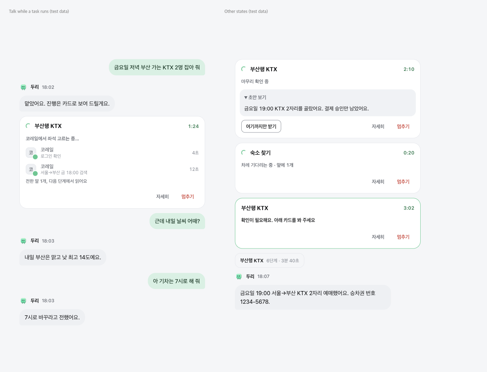

# ProgressCard
**One card per request** while Dool2 works, in the conversation. It replaces a stack of "working" lines and early
answers: steps update in place, and the answer is a **draft** inside the card until the before-finishing check passes
(ADR 0027). The person receives exactly one result message per request.
Code: states from `finishProgress` in `@dool2/protocol/rich`, styles in `.workcard` + `.wc-*` of `packages/ui/ui.css`.

## States

| State | Title line | Inside | Buttons |
| --- | --- | --- | --- |
| Working | what it is doing now ("코레일에서 열차 찾는 중") | the last few steps, grouped by place (AgentLog rows) | `멈추기` |
| Checking | `마무리 확인 중` | `초안 보기` folds out the draft answer | `여기까지만 받기` · `멈추기` |
| Continuing | `빠진 부분 이어서 하는 중: 보험사 2곳 더 비교` (the judge's `next`) | the steps of this round; `앞서 쓴 초안` folds out the previous draft | `여기까지만 받기` · `멈추기` |
| Done | folds into one line above the answer (`열차 조회 완료 · 3단계 · 42초`) | the steps, on tap | none |

- **Elapsed time, never a remaining-time estimate**: `1:24` on the right of the title, tabular figures.
- The draft panel is a `surface-sunken` area inside the card, not a card in a card. Closed by default.
- `여기까지만 받기` ("take it as is") is secondary (outline): it makes the current draft the result and stops further
  rounds. `멈추기` is a text button in `danger`: it only stops. No other buttons.
- When the check **passes**, the card goes away and the draft appears as the answer message as it was. When it sends
  the work back, the title changes to the continuing line; the draft never shows as an answer first.

## Left (limit reached)
When the check reached its round or time limit, one quiet card goes below the answer: `아직 남은 것` + one line (what
is left) + `이어서 하기` ("continue", secondary). Only in this case. The button sends Dool2 back to it; after a new
message it greys out.

## Voice
Plain words, Dool2's tone (docs/persona.md): `마무리 확인 중`, `빠진 부분 이어서 하는 중: …`, `여기까지만 받기`,
`아직 남은 것`, `이어서 하기`. No "AI", "verdict" or "judge".

## Right away and on return
- **Received**: the moment a message reaches the PC, before the AI is called, the card shows with `생각하는 중…`
  (live `ack`). The time to it is counted next to the time to the first word (daily stats `ackMsP50`).
- **Return summary**: opening the app after 20 minutes or more away shows one quiet card at the end of the
  conversation, made from stored records only (no AI): `자리 비운 사이에`, `끝낸 일 N개` (up to 3 titles), and
  `기다리는 일` with what happens without an answer (`14:20까지 답이 없으면 하지 않아요`). `확인했어요` or a new message
  closes it. Code: `awaySummary` in `@dool2/protocol/work-steps`.

## Task card (ADR 0038)
With task sessions on, work the conversation hands over (`task_start`) gets the same card, saved in the conversation
where it started and redrawn in place while the conversation goes on. Code: `taskCard` (desktop) and `taskInline`
(phone), state from `TaskView` (`GET /api/tasks`, live `task` events).

| State | Title line | Second line | Buttons |
| --- | --- | --- | --- |
| Waiting | the task's name | `차례 기다리는 중 · 앞에 1개` (one browser at a time) | `자세히` · `멈추기` |
| Working | the task's name | what it does now (`코레일에서 열차 찾는 중…`) + the last 3 steps | `자세히` · `멈추기` |
| Needs you | the task's name, brand outline | `확인이 필요해요. 아래 카드를 봐 주세요` (the approval or sign-in card is below in the conversation) | `자세히` · `멈추기` |
| Checking / continuing | the task's name | `마무리 확인 중` / `빠진 부분 이어서 하는 중: …` + `초안 보기` | `여기까지만 받기` · `자세히` · `멈추기` |
| Done / stopped | one line: name · `N단계 · 42초` / `멈췄어요` / `하다가 멈췄어요` | the steps, on tap | `자세히` |

- The title is the task's name, not the step: several tasks can be on screen at once, and the name tells them apart.
- A note the person passed on shows as `전한 말 1개, 다음 단계에서 읽어요` until the task reads it.
- The result is a normal Dool2 message at the end of the conversation, once. The card stays where the task started.
- `자세히` opens the task's own chat (PC: inside the card; phone: the side-chat screen).

